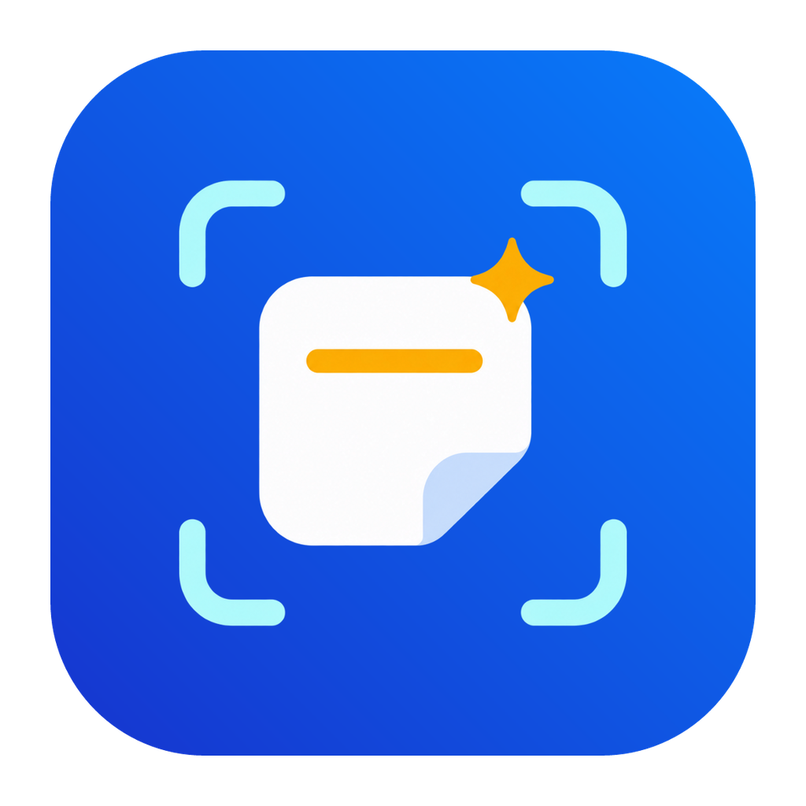

# Snapclip

**Snapclip** (**闪贴** in Chinese) is this project’s product brand, with its own app and menu bar marks. All shortcuts live in **Settings → Shortcuts**, grouped into Open app, Switch groups, Paste actions, and Screenshots cards. The Screenshots pane contains capture behavior and translation options. This document describes the current source; check the [download section](#download-and-use) and the corresponding Release notes for an installer’s actual version and features.

<p align="center">
  
</p>

**A free, local clipboard manager for macOS.** Save what you copy, browse it as cards, and search and organize content you use often.

Snapclip supports **macOS 14+, Intel (x86_64), and Apple silicon (arm64)**. It is built with Swift, AppKit, and SwiftUI and needs no account from the original vendor. Optional [iCloud Drive file sync](docs/ICLOUD_SYNC.md) is off by default. The source also retains [CloudKit migration code](docs/CLOUDKIT_MIGRATION.md) requiring signing configuration. Check each installer’s release notes for its features. Both linked guides are in Chinese.

[](https://github.com/aexachao/Snapclip/actions/workflows/release.yml)

[Project](https://github.com/aexachao/Snapclip) · [Release status](https://github.com/aexachao/Snapclip/releases) · [Feature comparison](#paste-vs-snapclip) · [Build from source](#build-from-source) · [Contribute](CONTRIBUTING.md) · [License scope](NOTICE.md)

The project is hosted at [aexachao/Snapclip](https://github.com/aexachao/Snapclip). Website sources are in `website/`; GitHub Pages is not enabled yet. Future downloads will point only to verified assets actually published in this repository.

All six shortcut recorders in **Settings → Shortcuts** have a right-side × to clear the binding and display **Not Set**. Clearing Region or Full Screen disables only that shortcut; the capture menu remains available, and the cleared state survives restart. Each option shows **Restore Default** immediately to the shortcut’s left only when modified. **Restore All Shortcuts…** requires confirmation and restores all six combinations and both paste modifiers. Cancelling writes nothing; a failed save preserves the old values and shows an error. The Helper supports legacy and user-renamed app filenames. See [testing boundaries](replica/TESTING.md).

## Version 1.0.10 source updates (installer not yet published)

The screenshot editor no longer exposes image-host upload without configuration. Settings copy is shorter, and **Help & Guide** opens this project on GitHub. Repository and update URLs now belong to `aexachao/Snapclip`; persistent data and signing identities are retained. Source pushes and version tags validate contracts; publishing an installer requires an explicit manual action.

Settings now groups General, Clipboard & History, Screenshots, Shortcuts, Privacy & Permissions, and AI Tools. All shortcuts live together. Restore All Shortcuts requires confirmation; cancellation or a failed save preserves existing values. History retention offers 1, 3, 7, 15, 30, or 60 days and Forever. Shortening requires confirmation and removes only expired items outside groups.

Region and full-screen screenshots open an annotation editor with scrolling capture, OCR, and pinning. Confirm adds the image to history and the clipboard; Save only exports a file. Capture hides only the history panel. Permissions and Apple translation have dedicated settings. See the usage and limits below.

This round also refines the panel’s top corners, source-icon fitting, and unchanged-sync checks. Copy and screenshot success feedback uses the built-in macOS Purr sound, loaded at runtime with `NSSound(named:)`; system audio is not copied into the app. The previous system Pop contains several audible segments in one playback, which may explain a doubled sound; duplicate playback calls were not established. Isolated tests confirm one screenshot success tone, one tone for each of two distinct copies, and silence on failure. Actual listening remains for user confirmation. Chinese and English copy is independently written; other languages fall back to English. The new app icon, paste illustrations, and permission illustration use the built-in image tool with the user’s approval; see [generation sources and prompts](branding/SnapclipGeneratedAssets/PROVENANCE.md). Its model ID is not exposed, so these are not attributed to gpt-image-2.5. The small category templates retain independent geometric drawing. [NOTICE](NOTICE.md) explains research and third-party rights; the [asset checklist](docs/BRAND_ASSET_REPLACEMENTS.md) tracks replacements. Branding work does not establish App Store acceptance, trademark availability, or completion of source-rights review.
The region/window initial snapshot now explicitly excludes the magnifier and hint windows while preserving ordinary settings windows. Native tests use injected snapshot providers; live ScreenCaptureKit pixels and this round’s installation acceptance are tracked separately in [TESTING](replica/TESTING.md). The earlier Purr/chrome-fix arm64 1.0.9 build was installed with stable development signing; the delivery worker verified inputs, installed files and a 12-second launch. All 26 final independent deployment checks and the parent agent’s direct file/process checks passed; this does not establish live ScreenCaptureKit pixels or physical listening.


The local arm64 app is now 1.0.10: 392 product inputs and 192 source/installed manifest entries match, with stable development signing, backup restoration, the running app path, and 20 independent deployment checks passed. Extracted research resources are excluded. No public installer has been released in this repository. Earlier 1.0.9 UI, artwork, Purr, and capture-chrome evidence remains in [testing notes](replica/TESTING.md). Live SCK pixels, listening, user history, TCC changes, native Intel hardware, and older systems were not validated in this round.

## Historical record · Version 1.0.8 search interaction fixes

Fixes a transparent input layer intercepting clicks on the panel's search icon. The button follows the original native action path, activating search and input focus during the click action. Click the icon or press ⌘F inside the panel to search.

Targeted checks use isolated synthetic data on Apple silicon with macOS 26.2 and SDK 26.5. They cover 27 hit points, three mouse and keyboard cycles, filtering, and repeated transitions. Clicking and typing in the installed app also passed. Native Intel hardware and older macOS versions remain untested. Ad-hoc signed updates may still need Accessibility access enabled again.

## Historical record · Version 1.0.7

This release gives 1.0.6 users a newer version to test in-app updates. Open **About Snapclip → Check for Updates → Download and Install** to upgrade to 1.0.7. Accessibility access may still need to be enabled again after updating.

## Historical record · Version 1.0.6 in-app updates

Version 1.0.6 adds **Check for Updates** and **Download and Install** to **About Snapclip**. Opening About checks the latest stable GitHub Release asynchronously and reuses results for six hours. After confirmation, Sparkle downloads the complete Universal DMG, verifies Ed25519 signatures on the update feed and archive, installs it, and relaunches Snapclip. The existing quit flow saves local data before installation. Ad-hoc signed updates may still require macOS Accessibility access to be enabled again.

The request contains only public release information. Offline and failed checks can be retried while clipboard features remain available. **Published installers through 1.0.5 do not contain this entry. Install 1.0.6 or a newer version manually first.**

A local isolated app completed a real Sparkle download, installation, and relaunch, but lost Accessibility authorization after the update. See the [test record](reports/replica/in-app-update-accessibility-test-2026-11-04.md) (Chinese).

## Historical record · Version 1.0.5 compatibility fixes

Fixes resource-loading crashes when opening Settings after installation and failures importing some Paste collections. Updates resource lookup, older-system appearance branches, and universal packaging while preserving existing local history and collections.

Targeted arm64 and Rosetta x86_64 tests passed. Older macOS releases and native Intel hardware still need testing. Upgrade legacy v4/v5-old databases with a current Paste version before importing. See the [compatibility migration report](reports/replica/paste-compatibility-migration-2026-11-04.md) (Chinese).

## Screenshots

Actual app screenshots using isolated sample data, with no real clipboard history. The app interface shown is in Chinese.

Clipboard panel:


Settings:


## Features implemented in the source

- Clipboard history that preserves multiple content formats: text, images, files, links, and colors.
- A horizontal card panel, search and filters, multiple selection, previews, and local editing.
- Collections (Pinboard), a Snapclip Stack queue, and archive import and export.
- Migration of local collections and their contents from Paste, preserving colors and order. Repeated imports do not overwrite existing edits. Open the More menu → Import collections from Paste…; see the [migration guide](replica/README.md#从-paste-迁移分组) (Chinese).
- Global keyboard shortcuts, configurable plain-text actions, recording pause, and local settings.
- Local Vision OCR and a separate `snapclip-mcp` stdio service.
- Screenshots and the annotation editor: ⌘⇧A region capture and ⌘⇧E full-screen capture open the annotation editor directly after selecting a region or pressing the shortcut, with rectangles, arrows, pen, mosaic, spotlight, text, QR codes, OCR, and pin.
- Scrolling capture: automatic scrolling needs macOS Accessibility access, manual scrolling needs no permission, and a crop step runs before returning to the editor.
- Pinned screenshots (pin) and image text recognition (OCR) work in local testing; `,` and `.` page through earlier images inside the editor.
- Screenshot behavior and Apple Translation (macOS 15+) are configurable in **Settings → Screenshots**. Real Apple English/Chinese translation and synthetic-image OCR text routed to the translation service passed locally; visible translation panel results and errors remain unverified. The screen recording entry exists and is not yet verified.

**Snapclip is an independent implementation in development. Full one-to-one verification against the original is not complete.** The list above means source code and feature entry points exist; it does not mean every interaction or edge case has been verified. Cross-app direct paste has not been fully verified, so correct insertion at the cursor cannot be guaranteed in every app. When reporting copy or paste issues, include reproduction steps without private content.

## Screenshots and scrolling capture

⌘⇧A starts a region capture: a dimmed overlay and crosshair appear, and releasing the mouse after dragging a selection opens the annotation editor directly. Press Esc to cancel without creating an entry. ⌘⇧E captures the current screen into the same editor.

**Confirm** in the editor writes the image into Snapclip history and it can be pasted with ⌘V immediately; **Save** only exports a file and does not add history, which is the intended behaviour. The tool strip includes rectangles, arrows, pen, mosaic, spotlight, text, QR codes, OCR, and pin. Use `,` and `.` to page through earlier images inside the editor.

While capturing, only the Snapclip history panel hides; Settings, About, ordinary editors, and their confirmation sheets stay visible. The history panel returns after cancelling. Double-clicking the overlay suspends the capture, and the next ⌘⇧A resumes annotation.

**Scrolling capture** is the button in the vertical tool strip on the right side of the editor:

- Automatic scrolling injects wheel events into the target window and needs macOS Accessibility access; manual scrolling uses your own wheel and needs no permission. A crop step follows, and confirming returns to the editor.
- Two paths work in testing: drawing a rectangle with ⌘⇧A, and double-clicking the overlay, resuming, then dragging a rectangle.
- **Selection rule (important):** the selection may contain only the scrolling content. Framing the window title bar, toolbar, or tab bar makes automatic scrolling stop silently part-way, with no message and no history entry; drag the top edge down so the fixed bars sit outside the selection and it runs to completion.
- The **Scrolling capture** button is disabled by default for window snap (clicking a window with ⌘⇧A) and ⌘⇧E full-screen capture; this is upstream behaviour. After snapping, dragging a selection edge enables it, but the selection rule above still applies.
- Capture behavior and the Apple Translation switch are available in **Settings → Screenshots**; region and full-screen shortcuts are in **Settings → Shortcuts → Screenshots**. Capture integration, translation, and Chinese/English settings persistence have limited verification; history timestamps now refresh after duplicate screenshots save. See [testing notes](replica/TESTING.md) for current regression results and boundaries. The real capture engine/Carbon and visible translation panel need separate validation. The screen recording entry exists and is not yet verified as working.
- Pin and OCR work in local testing. Not yet verified: the window-snap gate, multiple displays, the stitch quality of automatic scrolling, and scrolling capture in other apps. The installer is ad-hoc signed, so updates may still require enabling Accessibility access again; the editor's **Open Settings** button now opens screenshot settings; the pin window's **Edit** button remains a placeholder.

## Paste vs. Snapclip

**Snapclip is free and open source, focused on local use on Mac.** ✅ Available · ❌ Not available

| Core feature | Paste | Snapclip |
| --- | :---: | :---: |
| Clipboard history and content previews | ✅ | ✅ |
| Search and filters | ✅ | ✅ |
| Collections | ✅ | ✅ |
| Single and batch copy and paste | ✅ | ✅ |
| Sequential paste with Stack | ✅ | ✅ |
| Text recognition in images (OCR) | ✅ | ✅ |
| Custom keyboard shortcuts | ✅ | ✅ |
| AI tool integration (MCP) | ✅ | ✅ |
| Apple Shortcuts | ✅ | In development / unverified |
| iCloud sync between Macs | ✅ | ✅ |
| iPhone / iPad apps | ✅ | ❌ |
| Shared collections and collaboration | ✅ | ❌ |
| Online link previews | ✅ | ❌ |

Snapclip also supports [importing local collections from Paste](replica/README.md#从-paste-迁移分组). ✅ means implemented; full interactions and cross-app paste still need comprehensive verification. See the [feature and testing scope](replica/TESTING.md) (Chinese). This comparison covers Paste 6.6.6 and Pasto 1.0.5. For Paste's sync and collaboration features, see the [Paste website](https://pasteapp.io/).

The development source has App Intents entry points. System discovery, real shortcut execution, and migration of saved shortcuts remain unverified; stable 1.0.8 does not provide them. Retaining the main app module and Intent type identifiers is a compatibility measure, not evidence that saved shortcuts migrated successfully.

## iCloud sync

The primary option is **iCloud Drive file sync**, which does not require a paid developer membership. Turn on **iCloud sync** in **Settings → General**. Snapclip automatically uses `iCloud Drive/Pasto`, with no folder picker or setup dialog. Use the same Apple ID and enable the switch on another Mac. It merges clipboard history, original content, and collections, including additions, edits, and deletions. It is off by default. See the [usage and verification guide](docs/ICLOUD_SYNC.md) (Chinese).

Properly signed builds can also show an advanced option migrated from the original CloudKit flow, using Snapclip's own container and disabled by default. Valid Apple signing credentials and container configuration are currently missing, and live CloudKit testing is incomplete. It does not connect to the original vendor's cloud data or provide mobile apps or shared collaboration.

CloudKit remains an advanced option for properly signed builds and cannot run alongside file sync. File upload results do not verify CloudKit behavior. See the [CloudKit notes](docs/CLOUDKIT_MIGRATION.md) (Chinese) for migration evidence, isolated tests, and outstanding work. Snapclip uses iCloud Drive file sync. End-to-end sync across real devices still needs full validation.

## Download and use

This repository has no published installer yet. Build from source below; [Releases](https://github.com/aexachao/Snapclip/releases) will list future published versions. The local verification uses a stable development signature; Developer ID notarization and App Store validation are not complete.

<!-- pasto-download:start -->
This repository has no published installer yet. Build from source below; future installers will appear in [Releases](https://github.com/aexachao/Snapclip/releases).
<!-- pasto-download:end -->

The main app, Helper, and MCP executable all include both architectures. There is no need to choose a chip-specific download. Check each older release's notes for its package format and supported architectures.

If a future published DMG is available, drag `Snapclip.app` into `Applications`, launch it there, then eject the disk image. Current source builds also produce `Snapclip.app`.

Direct paste into other apps requires macOS Accessibility access. Granting permission does not mean the feature has passed full compatibility testing.

In current source builds, choose **Continue** to skip the permission guide, then review status and open System Settings under **Settings → Privacy & Permissions → System Permissions**. Status updates when you return; **Refresh Status** retries immediately. Checking, failed checks, inactive access, and new grants requiring a restart have separate text labels beside their colors. Accessibility authorization and direct-paste availability are separate. Quit and reopen the app when prompted. If access is still unavailable after authorization, expand the help and follow its steps to review old entries and add the current installation again. Monitoring never requests access or restarts the app. Signing changes may require authorization again.

Snapclip stores clipboard content locally. Screenshots, logs, and archives may contain personal information; review them before sharing. Prefer fictional text and temporary files when reproducing an issue.

## Build from source

You need macOS 14+, an Intel or Apple silicon Mac, Xcode Command Line Tools (the Swift toolchain), and Python 3. Use Xcode 26 or newer Command Line Tools for the native macOS 26 control design; the minimum runtime remains macOS 14. The first build downloads a checksum-pinned Sparkle framework through SwiftPM.

Run local builds, tests, and packaging through a configured `storage-guard`. From the repository root, this command puts scratch data, module caches, and temporary files in the task’s `build/`, and the final app in `out/Snapclip.app`:

```sh
~/dev-artifacts/bin/storage-guard run --repo pasto --task app-build -- /bin/bash -c '
  export TMPDIR="$ARTIFACT_TASK_DIR/build/tmp/"
  export CLANG_MODULE_CACHE_PATH="$ARTIFACT_TASK_DIR/build/module-cache"
  export SWIFTPM_MODULECACHE_OVERRIDE="$CLANG_MODULE_CACHE_PATH"
  export SNAPCLIP_BUILD_ROOT="$ARTIFACT_TASK_DIR/build/swiftpm"
  export SNAPCLIP_APP_OUTPUT_DIR="$ARTIFACT_TASK_DIR/out"
  mkdir -p "$TMPDIR"
  bash replica/scripts/build-app.sh release universal
'
```

The default is a Universal app. Replace `release universal` in the last line with `debug native` for a debug build of the current Mac’s architecture. The bundle includes resources, the login helper, and the MCP executable, and local signatures are checked. A successful build does not verify application behavior.

If this Mac has a valid Apple Development identity, set `SNAPCLIP_SIGNING_IDENTITY` to its name or certificate SHA-1 inside the managed build command and use the same identity for subsequent local builds. Without it, builds remain ad-hoc signed. The first switch may require adding permissions again; stable signing does not automatically inherit old grants or change the signing and notarization status of published installers.

Create the release-format Universal DMG and signed update feed:

```sh
~/dev-artifacts/bin/storage-guard run --repo pasto --task release-package --kind release -- /bin/bash -c '
  export TMPDIR="$ARTIFACT_TASK_DIR/build/tmp/"
  export CLANG_MODULE_CACHE_PATH="$ARTIFACT_TASK_DIR/build/module-cache"
  export SWIFTPM_MODULECACHE_OVERRIDE="$CLANG_MODULE_CACHE_PATH"
  export SNAPCLIP_BUILD_ROOT="$ARTIFACT_TASK_DIR/build/swiftpm"
  export SNAPCLIP_APP_OUTPUT_DIR="$ARTIFACT_TASK_DIR/out"
  export SNAPCLIP_RELEASE_OUTPUT_DIR="$ARTIFACT_TASK_DIR/out/release"
  mkdir -p "$TMPDIR"
  npm run build:dmg
'
```

Stable versions require the release private key configured outside the repository to generate the signed update feed. This command packages locally and does not publish. The app is in `out/Snapclip.app`, and release assets are in `out/release/`. For a local verification image without a release feed, call `build-dmg.sh` in the same managed command after building, passing that app and a new `.dmg` destination under the task’s `out/`; existing destinations are never overwritten.

Explicit `SNAPCLIP_APP_OUTPUT_DIR`, `SNAPCLIP_RELEASE_OUTPUT_DIR`, and `SNAPCLIP_BUILD_ROOT` values take precedence. Managed defaults are `out/`, `out/release/`, and `build/swiftpm/`. Unguarded legacy defaults remain for existing hosted CI compatibility; local work must not write outputs or caches under the repository.

Compile for the current Mac without packaging an app:

```sh
~/dev-artifacts/bin/storage-guard run --repo pasto --task compile -- /bin/bash -c '
  export TMPDIR="$ARTIFACT_TASK_DIR/build/tmp/"
  export CLANG_MODULE_CACHE_PATH="$ARTIFACT_TASK_DIR/build/module-cache"
  export SWIFTPM_MODULECACHE_OVERRIDE="$CLANG_MODULE_CACHE_PATH"
  mkdir -p "$TMPDIR"
  swift build --package-path replica --scratch-path "$ARTIFACT_TASK_DIR/build/swiftpm" -c release
'
```

More development information is available in [replica/README.md](replica/README.md) and the [testing scope](replica/TESTING.md), both in Chinese.

Build configuration uses `SNAPCLIP_*`, with legacy `PASTO_*` aliases retained; the new names take priority when both are set. The new MCP executable is `snapclip-mcp`, with `pasto-mcp` retained as a compatibility entry. The main `Pasto` app module, Intent types, Bundle ID, data/archive/cloud identifiers, and helper service path remain for compatibility.

## Automated builds and releases

Pushes to `main` and `v<version>` tags run release contract checks only. To publish an installer, manually run **Build and release Snapclip** with the explicit `publish` option enabled; it defaults to false. Signing keys and release prerequisites must be configured first.

The workflow keeps a native Intel build check, then validates the Universal package's version, both architectures in all three executables, and signatures. Stable releases publish four assets, including `Snapclip-<version>-macos-universal.dmg`, `SHA256SUMS.txt`, `release-manifest.json`, and the signed `appcast.xml` feed. Stable publishing requires the `PASTO_UPDATE_PRIVATE_KEY` Actions Secret. See [in-app updates](docs/APP_UPDATES.md) (Chinese). The Release becomes public only after upload verification succeeds. Versions ending in `-dev.N` are prereleases; stable releases are marked as latest. A version does not overwrite artifacts from another commit, and failed runs do not publish a stable Release.

The `Source code (zip)` and `Source code (tar.gz)` links on a Release page are generated by GitHub for the tag. They are not installers or additional assets uploaded by this workflow.

After a stable Release is published successfully, Actions reads the latest uploaded Universal DMG, updates both READMEs and the website download buttons and version labels, and deploys GitHub Pages only after configuration and SNAPCLIP_PAGES_ENABLED=true. Failed builds and prereleases do not replace the stable download.

See the [release workflow](.github/workflows/release.yml). A successful build and release does not imply successful functional regression testing.

## Project origins and verification limits

Snapclip is independently rewritten using **Paste 6.6.6** static reverse-engineering evidence from REA / Ghidra. Decompiled pseudocode is not a directly buildable original Swift project. This project is not affiliated with or endorsed by the original vendor, and does not modify the original app or its licensing.

The existing original machine-code analysis and address evidence are from **arm64**. Providing one Universal DMG with both architectures does not mean the original x86_64 app has been decompiled or that all features have passed regression testing on Intel and Apple silicon.

See the [reverse-engineering notes](docs/REVERSE_ENGINEERING.md) for the research process and the [consolidated feature audit](reports/replica/fast-coverage-audit.md) for current evidence and remaining differences; both are in Chinese. Binary address counts, exported pseudocode counts, and registered implementation counts cannot be converted into a product completion percentage. A successful build, installation, or individual action also does not constitute full interaction verification.

## Open-source license

The independently written implementation, tools, documentation, and documented independently created graphics are open source under the [MIT License](LICENSE). **This license does not cover decompiled output from the original app, recovered assembly, original localization resources, or other original materials.** See [NOTICE.md](NOTICE.md) for the scope and rights applicable to each part.
