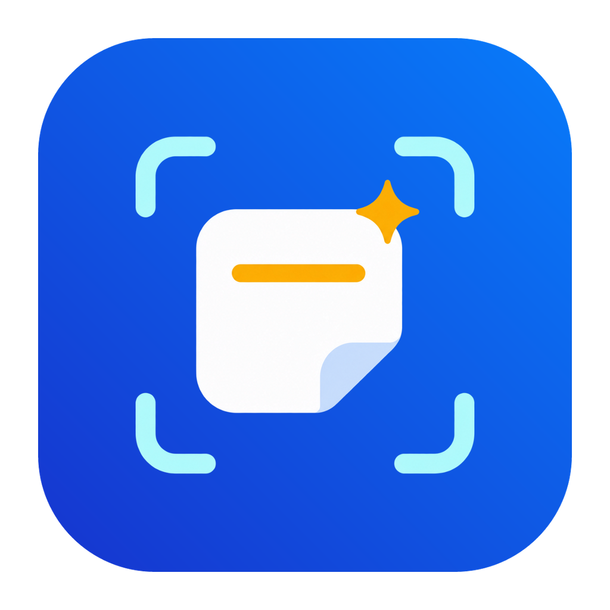

# 闪贴（Snapclip）

**闪贴 / Snapclip** 是本项目的产品品牌，使用独立的启动图标与菜单栏标志。所有快捷键集中在 **设置 → 快捷键**，按应用唤起、分组切换、粘贴操作和截图分卡片设置；截图页只保留截图后行为与翻译选项。本文介绍当前源码；安装包的实际版本与功能以[下载区域](#下载与使用)和对应 Release 说明为准。

<p align="center">
  
</p>

**免费的本地 macOS 剪贴板工具。** 保存拷贝记录，用卡片浏览、搜索和整理常用内容。

闪贴 面向 **macOS 14+，支持 Intel（x86_64）和 Apple 芯片（arm64）**，使用 Swift、AppKit 和 SwiftUI。无需原厂账号。提供默认关闭的 [iCloud Drive 文件同步](docs/ICLOUD_SYNC.md)，并保留需配置签名的 [CloudKit 迁移代码](docs/CLOUDKIT_MIGRATION.md)。各安装包的实际功能以对应发布说明为准。

[](https://github.com/aexachao/Snapclip/actions/workflows/release.yml)

[项目主页](https://github.com/aexachao/Snapclip) · [发布状态](https://github.com/aexachao/Snapclip/releases) · [功能对比](#paste-与-闪贴-功能对比) · [源码构建](#源码构建) · [参与贡献](CONTRIBUTING.md) · [许可范围](NOTICE.md)

项目仓库为 [aexachao/Snapclip](https://github.com/aexachao/Snapclip)。`website/` 保存官网源码；GitHub Pages 尚未启用。首次正式安装包发布后，下载信息才会指向本仓库已验证的附件。

在 **设置 → 快捷键** 中，六个快捷键录制器均可点击右侧 × 清空，显示“未设置”；区域 / 全屏截图清空后只取消对应快捷键绑定，菜单中的截图功能保留，重启后保持未设置。每个选项仅在偏离默认值时，才在快捷键左侧显示“恢复默认”，可单独恢复；顶部“恢复全部快捷键…”须确认后恢复六条组合及两项粘贴修饰键。取消不写入，保存失败保留原值并就地报错。Helper 按应用标识定位主程序，兼容新旧包名和用户改名。详见[测试边界](replica/TESTING.md)。

## 本次更新 · 1.0.10（尚未发布安装包）

移除截图编辑器的“上传到图床”入口，精简设置中的冗余说明。“帮助与指南”直达本项目 GitHub。仓库、更新检查和更新源迁至 `aexachao/Snapclip`，保留既有数据与签名兼容标识。推送与版本标签只校验契约，公开安装包需要显式手动发布。

设置按通用、剪贴板与历史、截图、快捷键、隐私与权限、AI 工具六页整理。全部快捷键统一管理；“恢复全部快捷键…”须确认后执行，取消和保存失败保留原值。历史保留提供 1、3、7、15、30、60 天和永久；缩短周期须确认，只清理过期且未加入分组的内容。

截图支持区域 / 全屏捕获和标注编辑器，另提供长截图、OCR 与钉图。“确认”加入历史并写入剪贴板，“保存”只导出文件。截图时只收起历史面板；权限与 Apple 翻译在对应设置页管理。完整操作和限制见下文。

本轮还调整了历史面板顶角、来源图标适配与同步无变化检查。复制和截图成功反馈按用户选择使用 macOS 自带 Purr 提示音，通过 `NSSound(named:)` 在运行时加载，不将系统音频复制进应用；原系统 Pop 单次包含多个声段，可能形成重复响声的听感，尚未证明存在重复播放调用。隔离测试确认截图一次成功声、连续两次不同复制各一次、失败无声；实际听感仍待用户确认。中英文文案独立重写，其他语言回退英文。新的启动图标、粘贴说明与权限插图按用户确认使用当前内置图像工具生成，来源与提示词见[生成素材记录](branding/SnapclipGeneratedAssets/PROVENANCE.md)；工具未公开模型 ID，不称为 gpt-image-2.5。20pt 类别模板保持独立几何绘制。原研究材料与第三方许可的边界见 [NOTICE](NOTICE.md)，逐项替换进度见[素材清单](docs/BRAND_ASSET_REPLACEMENTS.md)。品牌替换不表示商店审核、商标或全部来源权利审查已经完成。
区域 / 窗口截图的初始快照已在源码补齐放大镜与取色提示浮层的具体窗口排除，正常设置窗口仍可截取；原生注入快照定向测试通过，真实 SCK 像素与本轮联合安装验收分别记录于 [TESTING](replica/TESTING.md)。 此前 Purr / 浮层修复 arm64 1.0.9 已稳定签名安装，输入、安装清单与12秒启动观察通过实施自验；最终独立部署审计26项及主控实际文件 / 进程复核通过；不冒称真实 SCK 像素或实体试听通过。


当前本机已替换为 arm64 1.0.10：392 个产品输入与源 / 安装 192 条清单一致，稳定开发签名、旧包备份与运行路径通过实施验收及独立部署审计20项。旧提取资源不随包发行，本仓库尚无公开安装包。此前 1.0.9 的界面、素材、Purr 与浮层修复记录作为历史保留于[测试说明](replica/TESTING.md)。真实 SCK 像素、听感、用户历史、TCC 变化、Intel 真机和旧系统仍未完成本轮验收。

## 历史记录 · 1.0.8

修复面板顶部放大镜被透明输入层拦截点击的问题，并对齐原版按钮调用链，点击时即展开搜索并获取输入焦点。点击放大镜或在面板内按 ⌘F 可进入搜索。

定向验证使用 Apple 芯片 Mac、macOS 26.2、SDK 26.5 和隔离合成数据，覆盖 27 个命中点、三轮点击与快捷键、输入筛选及反复开关。本机实际点击输入已验证，Intel 真机和旧系统待验证。当前临时签名更新后仍可能需要重新开启辅助功能授权。

## 历史记录 · 1.0.7 应用内更新验证

本版供 1.0.6 用户测试应用内更新。在 **关于 闪贴 → 检查更新 → 下载并安装** 中升级到 1.0.7。更新后的辅助功能授权仍可能需要重新开启。

## 历史记录 · 1.0.6 应用内更新

1.0.6 在 **关于 闪贴** 中提供“检查更新”和“下载并安装”。打开关于窗口后异步比较 GitHub 最新正式 Release，六小时内复用结果，也可手动重新检查。确认更新后，Sparkle 在应用内下载完整的 Universal DMG，验证更新源和安装包的 Ed25519 签名，安装后重启应用。安装前会通过已有退出流程保存本地数据。临时签名版本更新后仍可能需要重新开启 macOS 辅助功能授权。

检查仅请求公开版本信息。离线或请求失败时可重试，剪贴板功能可继续使用。**1.0.5 及更早的已发布安装包尚无此入口，需要先手动安装 1.0.6 或更新版本。**

本机隔离应用已完成实际 Sparkle 下载、安装和重启，但更新后辅助功能授权丢失。[查看实测记录](reports/replica/in-app-update-accessibility-test-2026-11-04.md)。

## 历史记录 · 1.0.5 兼容性修复

修复安装后打开设置时的资源加载闪退，以及部分 Paste 分组导入失败。补齐资源、旧系统外观和双架构打包兼容处理，保留本机已有历史及分组。

arm64 与 Rosetta x86_64 定向测试已通过，旧系统及 Intel 真机仍待复测。旧版 v4/v5-old 数据库请先用新版 Paste 升级。[查看兼容迁移报告](reports/replica/paste-compatibility-migration-2026-11-04.md)。

## 界面

以下为独立演示数据下的实际界面截图，不含真实剪贴板历史。

剪贴板面板：


设置：


## 源码中已有的功能

- 剪贴板历史与多格式内容保留，支持文本、图片、文件、链接和颜色。
- 横向卡片面板、搜索筛选、多选、预览和本地编辑。
- 收藏分组整理、闪贴 Stack 队列、归档导入和导出。
- 从 Paste 迁移本地分组与组内内容，保留颜色和顺序；重复迁移不覆盖已有编辑。入口：更多 → 从 Paste 迁移分组…，详见[迁移说明](replica/README.md#从-paste-迁移分组)。
- 全局快捷键、可配置的纯文本操作、暂停采集与本地设置。
- 本地 Vision OCR，以及独立的 `snapclip-mcp` stdio 服务。
- 截图与标注编辑器：⌘⇧A 区域截图和 ⌘⇧E 全屏截图，拖选或按下快捷键后直接进入标注编辑器，提供矩形、箭头、画笔、马赛克、聚光灯、文字、二维码、OCR 和钉图等工具。
- 长截图（滚动截图）：自动滚动需要 macOS 辅助功能授权，手动滚动无需授权，结束后先裁剪再回到编辑器。
- 截图钉图与图片文字识别（OCR）已在本机实测可用；编辑器内可用 `,` 和 `.` 翻阅历史图片。
- 截图翻译可在“设置 → 截图”启用 Apple 翻译（macOS 15+）；本机已验证真实 Apple 中英互译和合成图片 OCR 文本到翻译服务，可见翻译面板结果/错误提示仍待验收；录屏入口存在，是否可用尚未验证。

**当前是开发中的独立实现，尚未完成与原版一比一的全面验收。** 上述项目表示已有源码和功能入口，不代表每个交互或边界都已验证。跨应用直接粘贴仍未完成验证，不能保证在所有应用的光标位置正确插入；复制与粘贴问题请附不含隐私的复现步骤。

## 截图与长截图

⌘⇧A 进入区域截图：出现遮罩和十字光标，拖动选区后松手直接进入标注编辑器；按 Esc 取消，不产生任何条目。⌘⇧E 直接抓取当前屏幕并进入同一个编辑器。

编辑器里的“确认”把图片写入 闪贴 历史，并可以立刻用 ⌘V 粘贴；“保存”只导出文件、不写入历史，这是预期行为。工具条包含矩形、箭头、画笔、马赛克、聚光灯、文字、二维码、OCR 和钉图，编辑器内用 `,` 和 `.` 翻阅历史图片。

截图时仅收起闪贴历史面板，设置、关于、普通编辑器及其确认框保持显示；取消后恢复历史面板。双击遮罩可以挂起本次截图，下次按 ⌘⇧A 时接着标注。

**长截图（滚动截图）** 位于编辑器右侧竖排工具条的“滚动截图”按钮：

- 自动滚动向目标窗口注入滚轮事件，需要 macOS 辅助功能授权；手动滚动由你自己滚动滚轮，不需要授权。结束后进入裁剪，确认后回到编辑器。
- 实测可用两条路径：⌘⇧A 手绘矩形，以及双击遮罩挂起后恢复再拖矩形。
- **选框规则（重要）：** 选框内只能包含滚动内容。把窗口标题栏、工具栏或标签栏框进去，自动滚动会中途静默结束，没有提示也不会写入历史；把上边缘往下拖，让固定栏落在框外即可正常跑完。
- 窗口吸附（⌘⇧A 点击窗口）和 ⌘⇧E 全屏这两条路径默认禁用“滚动截图”按钮，这是上游设计；窗口吸附后拖动一下选区边缘可以解禁，但同样要遵守上面的选框规则。
- 截图后行为与 Apple 翻译开关已接入“设置 → 截图”；区域与全屏截图快捷键统一在“设置 → 快捷键 → 截图”配置。截图接入、翻译及中英设置保留已有有限验证；重复截图保存后的历史更新时间已刷新。最新回归状态与边界见[测试说明](replica/TESTING.md)；真实截图引擎/Carbon 与可见翻译面板仍需独立验收；录屏入口存在，尚未验证是否可用。
- 钉图和 OCR 已在本机实测可用。尚未验证：窗口吸附门禁、多显示器、自动滚动的拼接质量，以及长截图在其他应用中的表现。当前安装包为临时签名，更新后可能仍需要重新开启辅助功能授权；编辑器内的“打开设置”已接到截图设置页，钉图窗口的“编辑”按钮仍是占位。

## Paste 与 闪贴 功能对比

**闪贴 免费、开源，专注 Mac 本地使用。** ✅ 已提供 · ❌ 未提供

| 核心功能 | Paste | 闪贴 |
| --- | :---: | :---: |
| 剪贴板历史与内容预览 | ✅ | ✅ |
| 搜索与筛选 | ✅ | ✅ |
| 收藏分组 | ✅ | ✅ |
| 单条与批量复制、粘贴 | ✅ | ✅ |
| Stack 顺序粘贴 | ✅ | ✅ |
| 图片文字识别（OCR） | ✅ | ✅ |
| 自定义快捷键 | ✅ | ✅ |
| AI 工具接入（MCP） | ✅ | ✅ |
| 系统“快捷指令” | ✅ | 开发中 / 待验 |
| Mac 间 iCloud 同步 | ✅ | ✅ |
| iPhone / iPad 应用 | ✅ | ❌ |
| 分组共享与协作 | ✅ | ❌ |
| 联网链接预览 | ✅ | ❌ |

闪贴 另支持[从 Paste 迁移本地分组](replica/README.md#从-paste-迁移分组)。✅ 表示已有实现，完整交互及跨应用粘贴仍待全面验证，详见[功能与验证范围](replica/TESTING.md)。对照基于 Paste 6.6.6 及 Pasto 1.0.5；同步与协作介绍见 [Paste 官网](https://pasteapp.io/)。

开发源码已有 App Intents 入口；系统发现、真实快捷指令运行及既有快捷指令迁移未验，正式版 1.0.8 未提供。主 App 模块及 Intent 类型暂保留兼容标识，不代表旧快捷指令迁移已经通过。

## iCloud 同步

首选方式为 **iCloud Drive 文件同步**，无需付费开发者会员。在 **设置 → 通用** 打开 **iCloud 同步** 开关即可，自动使用 `iCloud Drive/Pasto`，无需选择目录或设置弹窗；其他 Mac 使用同一 Apple ID 并开启相同开关。支持历史、原始内容与收藏分组的合并、新增、编辑和删除。默认关闭，具体范围与验证记录见 [使用说明](docs/ICLOUD_SYNC.md)。

有效签名构建另可显示按原版 CloudKit 路径迁移的高级选项，使用 闪贴 自有容器，默认关闭。目前缺少有效 Apple 签名与容器配置，真实 CloudKit 云端测试尚未完成。它不连接 Paste 原厂云数据，也不提供手机端或共享协作。

CloudKit 作为已配置签名构建的高级选项，与文件同步不能同时开启；文件上传记录不计作 CloudKit 验收。当前迁移证据、隔离测试与未完成项见 [CloudKit 说明](docs/CLOUDKIT_MIGRATION.md)。闪贴 使用 iCloud Drive 文件同步，跨设备真实同步仍待完整验收。

## 下载与使用

本仓库尚无正式安装包。请按下方说明从源码构建；[Releases](https://github.com/aexachao/Snapclip/releases) 会列出未来实际发布的版本。当前本机验证使用稳定开发签名，未完成 Developer ID 公证或商店验收。

<!-- pasto-download:start -->
本仓库尚未发布安装包。请先按下方说明从源码构建；未来正式包见 [Releases](https://github.com/aexachao/Snapclip/releases)。
<!-- pasto-download:end -->

源码支持分别构建 arm64、x86_64 和 Universal；本轮本机验收仅覆盖 arm64。未来安装包的架构、签名和兼容范围以实际发布说明为准。

若后续下载到已发布 DMG，将 `Snapclip.app` 拖到 `Applications` 后从应用程序启动，再推出磁盘映像。当前源码构建产物同样名为 `Snapclip.app`。

跨应用直接粘贴需要 macOS 辅助功能权限；授权成功不等于该功能已通过完整兼容性验证。

当前源码的权限引导可选择“继续使用”，之后在 **设置 → 隐私与权限 → 系统权限** 查看状态并打开系统设置。返回应用后自动更新，也可点“刷新状态”。检查中、检查失败、权限未生效与新授权待重启分别显示，颜色旁保留文字；辅助功能授权与直接粘贴可用性分开表达。若提示重新打开应用，请退出后重开；授权后仍不可用时展开帮助，按提示检查旧条目并重新添加当前应用。检查不会申请权限或自动重启。签名变化后仍可能需要重新授权。

闪贴 在本机保存剪贴板内容。截图、日志和归档可能包含个人信息，分享前请检查。报告问题时优先用虚构文本和临时文件复现。

## 源码构建

需要 macOS 14+、Intel 或 Apple 芯片 Mac、Xcode Command Line Tools（Swift 工具链）和 Python 3。为获得 macOS 26 的原生控件外观，请使用 Xcode 26 或更新的 Command Line Tools；运行最低版本仍为 macOS 14。首次构建通过 SwiftPM 下载校验固定版本的 Sparkle 框架。

本地构建、测试和打包必须使用已配置的 `storage-guard`。下面的命令从仓库根目录执行，将 scratch、模块缓存和临时文件写到本次任务的 `build/`，最终应用写到 `out/Snapclip.app`：

```sh
~/dev-artifacts/bin/storage-guard run --repo pasto --task app-build -- /bin/bash -c '
  export TMPDIR="$ARTIFACT_TASK_DIR/build/tmp/"
  export CLANG_MODULE_CACHE_PATH="$ARTIFACT_TASK_DIR/build/module-cache"
  export SWIFTPM_MODULECACHE_OVERRIDE="$CLANG_MODULE_CACHE_PATH"
  export SNAPCLIP_BUILD_ROOT="$ARTIFACT_TASK_DIR/build/swiftpm"
  export SNAPCLIP_APP_OUTPUT_DIR="$ARTIFACT_TASK_DIR/out"
  mkdir -p "$TMPDIR"
  bash replica/scripts/build-app.sh release universal
'
```

默认构建 Universal 应用。将最后一行的 `release universal` 改为 `debug native` 可仅构建当前 Mac 的调试版。产物包含资源、登录项辅助程序及 MCP 可执行文件，并进行本地签名检查；构建完成不表示功能验收通过。

本机已有有效 Apple Development 身份时，可在受管构建命令中设置 `SNAPCLIP_SIGNING_IDENTITY` 为该身份的名称或证书 SHA-1，连续本地构建使用同一身份。未设置时仍采用临时签名；首次从临时签名切换后可能需要重新添加授权，稳定签名不等于自动继承旧授权，也不改变正式安装包的签名与公证状态。

制作正式发布格式的 Universal DMG 与签名更新源：

```sh
~/dev-artifacts/bin/storage-guard run --repo pasto --task release-package --kind release -- /bin/bash -c '
  export TMPDIR="$ARTIFACT_TASK_DIR/build/tmp/"
  export CLANG_MODULE_CACHE_PATH="$ARTIFACT_TASK_DIR/build/module-cache"
  export SWIFTPM_MODULECACHE_OVERRIDE="$CLANG_MODULE_CACHE_PATH"
  export SNAPCLIP_BUILD_ROOT="$ARTIFACT_TASK_DIR/build/swiftpm"
  export SNAPCLIP_APP_OUTPUT_DIR="$ARTIFACT_TASK_DIR/out"
  export SNAPCLIP_RELEASE_OUTPUT_DIR="$ARTIFACT_TASK_DIR/out/release"
  mkdir -p "$TMPDIR"
  npm run build:dmg
'
```

稳定版本生成签名更新源时需要项目外配置的发布私钥；此命令仅本地打包，不发布。应用位于任务的 `out/Snapclip.app`，附件位于 `out/release/`。只制作本地验证镜像时，在构建应用的同一个受管命令中调用 `build-dmg.sh`，输入该应用路径、输出任务 `out/` 中的新 `.dmg`；目标已存在会拒绝覆盖。

在受管任务中，`SNAPCLIP_APP_OUTPUT_DIR`、`SNAPCLIP_RELEASE_OUTPUT_DIR`、`SNAPCLIP_BUILD_ROOT` 的显式配置优先；缺省分别为 `out/`、`out/release/`、`build/swiftpm/`。无 guard 的旧目录默认值仅供现有 hosted CI 兼容，本地不使用仓库内 `dist/` 或缓存作为输出。

仅编译本机架构、不打包应用：

```sh
~/dev-artifacts/bin/storage-guard run --repo pasto --task compile -- /bin/bash -c '
  export TMPDIR="$ARTIFACT_TASK_DIR/build/tmp/"
  export CLANG_MODULE_CACHE_PATH="$ARTIFACT_TASK_DIR/build/module-cache"
  export SWIFTPM_MODULECACHE_OVERRIDE="$CLANG_MODULE_CACHE_PATH"
  mkdir -p "$TMPDIR"
  swift build --package-path replica --scratch-path "$ARTIFACT_TASK_DIR/build/swiftpm" -c release
'
```

更多开发说明见 [replica/README.md](replica/README.md) 和[测试范围](replica/TESTING.md)。

构建参数以 `SNAPCLIP_*` 为准，兼容已有 `PASTO_*` 别名；两者同时设置时新名优先。新 MCP 可执行文件为 `snapclip-mcp`，旧 `pasto-mcp` 入口保留。主 App 模块 `Pasto` 与 Intent 类型、Bundle ID、数据 / 归档 / 云标识及 helper 服务路径保留兼容，不代表漏改展示品牌。

## 自动构建与发布

推送 `main` 或 `v<版本号>` 标签只执行发布契约检查，不自动公开安装包。正式发布须在 Actions 手动运行 **Build and release Snapclip** 并明确勾选 `publish`；该选项默认关闭，签名密钥与发布前置必须先配置。

工作流保留 Intel 原生构建检查，再校验 Universal 安装包的版本、三项可执行文件的双架构及签名，正式版发布四个附件，包含 `Snapclip-<版本号>-macos-universal.dmg`、`SHA256SUMS.txt`、`release-manifest.json` 和签名更新源 `appcast.xml`。正式发布需配置 `PASTO_UPDATE_PRIVATE_KEY` Actions Secret，详见 [应用内更新](docs/APP_UPDATES.md)。上传校验成功后才公开 Release；`-dev.N` 版本标记为预发布，正式版本标为最新版本。同一版本不覆盖其他提交的产物，失败不会发布正式 Release。

Release 页面中的 `Source code (zip)` 和 `Source code (tar.gz)` 是 GitHub 自动提供的标签源码下载链接，不是安装包，也不是此发布流程额外上传的附件。

正式 Release 发布成功后，Actions 读取最新已上传的 Universal DMG，同步中英文 README、官网按钮和版本文案，仅当 Pages 已配置且仓库变量 SNAPCLIP_PAGES_ENABLED=true 时部署网站。构建失败或预发布版本不会替换正式版下载地址。

详见[发布工作流](.github/workflows/release.yml)。构建发布不代表功能回归通过。

## 项目来源与验证边界

闪贴 基于 **Paste 6.6.6** 的 REA / Ghidra 静态逆向证据独立重写；反编译伪代码不是可直接编译的原始 Swift 工程。本项目不隶属于或代表 Paste 原厂，不修改原版应用或其授权。

现有原版机器码分析与地址证据来自 **arm64**。闪贴 提供包含两个架构的单个 Universal DMG，不表示已反编译原版 x86_64，也不表示 Intel 与 Apple 芯片上的全功能回归均已通过。

研究过程见 [逆向研究说明](docs/REVERSE_ENGINEERING.md)；当前证据与剩余差异见 [集中功能核对报告](reports/replica/fast-coverage-audit.md)。二进制地址数量、伪代码导出数量和已登记实现数均不能换算为产品完成百分比；构建、安装和单项操作成功也不等于完整交互验收。

## 开源许可

独立编写的实现源码、工具、文档和有来源记录的自制图形按 [MIT License](LICENSE) 开源。**该许可不覆盖原应用的反编译产物、恢复汇编、原版本地化资源或其他原始素材。** 各部分范围及权利说明见 [NOTICE.md](NOTICE.md)。
